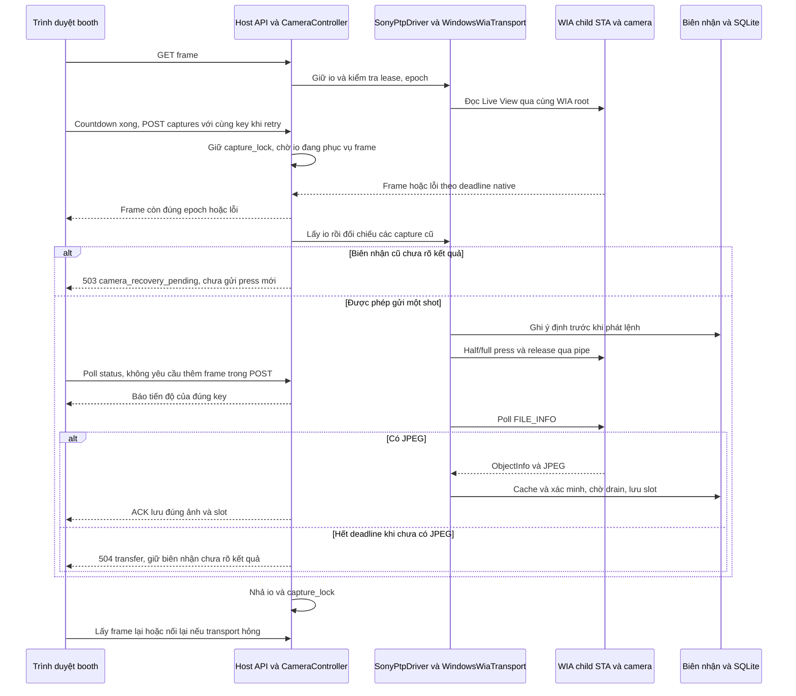

# P0.1 Kiểm toán độ tin cậy camera Sony ZV-E10

**21/11/2026 · Amazing Race 2026 Photobooth · Windows Host**

Có hai cách yêu cầu chụp đi tới trạng thái “đã bấm mà không có ảnh”. Một số yêu cầu dừng **trước khi gửi lệnh chụp** vì Host đang giữ một lần chụp trước chưa rõ kết quả. Một số khác đã qua chuỗi lệnh nhấn và nhả nhưng camera không báo có JPEG mới, dù Live View có thể tiếp tục. Với kết nối, log xác nhận Windows từng không khởi động được thiết bị và ứng dụng cũng có một đường phục hồi Live View giữ lại phiên WIA bị lỗi. Chưa có bằng chứng quy tất cả các sự cố về một worker cũ hoặc một nguyên nhân duy nhất.

Đối chiếu working tree của `Photobooth-amazing-race` trên `main` tại `7f2fe5b0cb85fbc9417b9cea07aabed8c4449b4a`, khớp ref `origin/main` lưu cục bộ. Giữ nguyên 82 file đã sửa từ trước. SQLite production được đọc với `mode=ro&immutable=1` sau khi kiểm tra không có WAL chứa dữ liệu. Đọc log và biên nhận, không gọi endpoint chụp, phục hồi capture hay hủy capture, không thay đổi cài đặt máy ảnh. Phụ lục lưu nguyên danh sách Git đầu kỳ.

## A. Kiến trúc và vòng đời kết nối

1. Windows USB/PnP khởi động thiết bị WPD. Host có thể phục vụ HTTP trước khi mở camera. `/api/health` chỉ kiểm tra Host và cơ sở dữ liệu.
2. `run_host.py` giám sát `serve_app.py`, chạy một Uvicorn worker cho private Host. Lifespan của FastAPI tạo `CameraController` và luồng kiểm tra hạn lease. Controller giữ file lock theo thư mục dữ liệu và cấp quyền camera cho một session khi `POST /camera/connect` thành công. Guest/public server không sở hữu camera. [Launcher](../scripts/run_host.py#L205) · [Lifespan](../backend/app/main.py#L73) · [Controller](../backend/app/services/camera/controller.py#L69)
3. `WindowsWiaTransport.open()` tạo một process Windows bằng `spawn` và một pipe. Luồng chính của child lấy mutex `Local\AmazingRace2026SonyWia`, gọi `CoInitializeEx` với STA **trước khi** tạo WIA Device Manager và liệt kê thiết bị, rồi `CreateDevice` và `QueryInterface(IWiaItemExtras)`. Mọi lời gọi COM, kể cả `Release`, nằm trên luồng này. Luồng đọc phản hồi bên Host chỉ đọc pipe vào queue một phần tử. Mutex chỉ phối hợp các chương trình cùng dùng tên mutex trong phiên Windows đó. Imaging Edge hoặc một client khác có thể dùng thiết bị mà không dùng mutex này. [COM và WIA](../backend/app/services/camera/sony_wia.py#L150) · [Worker và pipe](../backend/app/services/camera/sony_wia.py#L220)
4. `SonyPtpDriver.connect()` gửi `GetDeviceInfo 0x1001` qua WIA Escape, kiểm tra Sony ZV-E10 đời đầu, làm handshake `0x9201/0x9202`, rồi đọc properties `0x9209`. Driver chỉ đặt `connected=True` sau khi các bước này và việc nạp biên nhận hoàn tất. Bốn mức bằng chứng là **PnP hiện diện → WIA liệt kê → mở được WIA root → PTP giao tiếp thành công**. [PTP connect](../backend/app/services/camera/sony_ptp.py#L220)
5. Khi đóng bình thường, child xử lý `close` hoặc EOF rồi giải phóng `extras → root → manager`, gọi `CoUninitialize` và nhả mutex. PTP session cơ sở do WIA quản lý. Nếu native call không trả lời, parent có deadline và có thể buộc **child của nó** thoát. Terminate không chạy `finally` trong child. Nếu child chưa thoát trong thời gian chờ, transport giữ tham chiếu và chặn worker thay thế. Log `force=False` chỉ mô tả cách bắt đầu đóng vì vẫn có fallback terminate. Phải xem thêm trạng thái process. [Native call và close](../backend/app/services/camera/sony_wia.py#L192) · [Dừng Host](../scripts/serve_app.py#L33) · [Giám sát process Windows](../scripts/owned_processes.py#L19)

## B. Kết nối USB, WIA và PTP

- Log 20–21/11 ghi `0x80210006` ở cả `IWiaDevMgr.CreateDevice` và `IWiaItemExtras.Escape(0x1001)`. Lỗi thứ hai xuất hiện sau khi đã liệt kê camera, mở root và lấy được interface. Các lần “No Sony WIA camera” là một điểm hỏng khác, trước `CreateDevice`. Đêm 21/11, lỗi `0x1001` lặp lại sau các lần đóng worker có `worker_alive=False`. `WIA_ERROR_BUSY` không cho biết process hoặc thiết bị nào đang giữ tài nguyên. [Log WIA](../runtime/logs/private.log#L884) · [Mã lỗi WIA](https://learn.microsoft.com/en-us/previous-versions/windows/desktop/wia/-wia-error-codes)
- **Bằng chứng Windows bổ sung.** File `C:\Windows\INF\setupapi.dev.log`, dòng 32189–32237, ghi thiết bị Sony `VID_054C&PID_0D97` không khởi động ở lần restart thiết bị ngày 18/11 lúc 21:06:22. Mã là **Code 10** (`CM_PROB_FAILED_START`), problem status `0xc000009e`. Lần tiếp theo lúc 21:06:56 ghi `Restart verified`. Đây là bằng chứng có sự cố ở tầng thiết bị Windows và từng phục hồi bằng restart **thiết bị** trong lịch sử. Nó không liên kết trực tiếp với mọi lỗi WIA. Code 43 được người vận hành báo cáo, không xuất hiện trong các kiểm tra PnP hiện tại và chưa ghép được với một lỗi WIA cụ thể. [Microsoft Code 10](https://learn.microsoft.com/en-us/windows-hardware/drivers/install/cm-prob-failed-start) · [Microsoft Code 43](https://learn.microsoft.com/en-us/windows-hardware/drivers/install/cm-prob-failed-post-start)

## C. Live View và phục hồi

`/live-view/start` bật cờ preview trong driver. Nó không gửi lệnh bật Live View suy đoán. Khi lấy frame, Host đọc `D221` để kiểm tra Live View camera, gọi `GetObjectInfo` khi cần và `GetObject` với handle Live View, kiểm tra phần JPEG và trả về cùng số thứ tự và thời điểm lấy frame. Trình duyệt đọc JPEG, kiểm tra tuổi và giải mã trước khi đánh dấu preview khỏe. `/live-view/stop` tắt preview nhưng cố ý giữ quyền camera để cùng session tiếp tục thao tác. `disconnect`, hết lease hoặc shutdown mới đóng kết nối. Hai lần chạy Host phía dưới đã xác nhận hành vi này. [Driver preview](../backend/app/services/camera/sony_ptp.py#L270) · [API frame](../backend/app/camera_routes.py#L34) · [Giải mã và kiểm tra frame](../frontend/src/services/host-camera.js#L211)

- **Phiên WIA lỗi vẫn được dùng.** Ngày 21/11 lúc 00:24, preview gặp `0x8000FFFF`, `0x8007001F` và `0x8021000E` trên các lệnh đọc. `sony_wia._check()` trả `usb`. `SonyPtpDriver._command()` không hạ cờ kết nối cho loại này, `host-camera.readFrame()` không coi `usb` là lý do mở lại, và `CameraController.connect()` có thể trả về sớm cho chính chủ đang được báo `connected`. Người dùng thấy chờ preview hoặc nhấn Reconnect mà Host vẫn dùng root cũ. Với lỗi `busy` khi lấy frame, UI dừng polling sau sáu phản hồi liên tiếp nếu không có capture đang xử lý và yêu cầu thao tác lại. Cùng một nhãn UI có thể đến từ lease, I/O hoặc WIA busy. [Log lỗi đọc](../runtime/logs/private.log#L533) · [WIA mapping](../backend/app/services/camera/sony_wia.py#L76) · [PTP error](../backend/app/services/camera/sony_ptp.py#L195) · [Connect cùng session](../backend/app/services/camera/controller.py#L218) · [Frontend phục hồi](../frontend/src/services/host-camera.js#L279)
- **Worker đã thoát nhưng camera vẫn lỗi.** Ngày 20/11 lúc 10:35, GET frame trả 504 sau khi WIA child thoát, đọc kế tiếp báo disconnected, rồi lần mở mới không thấy camera trong WIA. Ngày 21/11 lúc 00:08–00:09 cũng bắt đầu bằng timeout và child thoát, nhưng lần mở mới gặp `CreateDevice` busy. Đây là hai trường hợp restart riêng worker không khôi phục được thiết bị. Không có bằng chứng rằng bắt buộc phải restart cả laptop. `not_ready` khi `D221` chưa sẵn sàng và timeout HTTP/giải mã phía trình duyệt vẫn cần được phân biệt với hỏng native transport. Browser abort không bảo đảm lời gọi WIA trên Host đã dừng. [Log 20/11](../runtime/logs/private.log.1#L24546) · [Log 21/11](../runtime/logs/private.log.1#L36344)

## D. Vị trí dừng của yêu cầu chụp

Countdown chuyển sang `CAPTURE` và gọi `capturePhoto`. Với Host, `captureHostPhoto()` kiểm tra frame còn mới nếu đây là yêu cầu mới, chuẩn bị session và key, rồi mới `POST /captures`. Thiếu preview, lệch session hoặc vướng khởi tạo có thể làm yêu cầu dừng tại UI trước POST. Không có log trình duyệt được đối chiếu để quy một lần bấm lịch sử cho đường này. Sau khi POST tới Host, kiểm tra quyền, trạng thái session, lease, dung lượng và cấu hình có thể chặn thêm. Event mode cũng có cổng `hardware_verified` riêng. Các ca bên dưới có POST và đã qua các bước đó. [Countdown](../frontend/src/features/capture/countdown.js#L87) · [Frontend gửi POST](../frontend/src/services/host-camera.js#L420) · [API](../backend/app/camera_routes.py#L51) · [Kiểm tra và chờ I/O](../backend/app/services/camera/controller.py#L407)

| Pha và giờ ICT | Bằng chứng | Kết luận |
| --- | --- | --- |
| **Trước shutter**, 20/11 23:14:10 và 21/11 00:41:33 | `d8395703` và `a8696ad0` có `preparing → waiting_io → reconciling → error`, `waiting_io=0 ms`. Cả hai POST trả 503. SQLite ghi `camera_recovery_pending`, không có `adapter_reference` hoặc biên nhận mới. GET frame ngay sau đó trả 200. [23:14](../runtime/logs/private.log.1#L29381) · [00:41](../runtime/logs/private.log#L1204) | Các request đã tới Host nhưng bị chặn **trước** `shutter_press` bởi biên nhận cũ chưa xác minh kết quả. Live View vẫn hoạt động. |
| **Sau ACK, thiếu JPEG**, 20/11 10:27–10:28 | Cùng session, `eef4db5b` đã lưu JPEG, xác nhận drain và trả 200 lúc 10:28:00. Shot `ec1f3bb4` bắt đầu khoảng 4,7 giây sau, qua press/release nhưng trả 504 ở `waiting_buffer`. Biên nhận giữ hai release ACK, `FILE_INFO=0`, chưa có ObjectInfo. [Shot 1 và 2](../runtime/logs/private.log.1#L22381) | Shot 2 thất bại dù shot 1 hoàn tất và buffer đã rỗng. Không có bằng chứng thao tác tải JPEG của shot 2 đã bắt đầu. |
| **Sau ACK, thiếu JPEG**, 20/11 23:12–23:13 | `e161a4a4` có `waiting_io=0 ms`, qua press/release, không báo JPEG qua 118 lần poll và trả 504 khi `connected=True`. Preview tiếp theo trả 200. Retry cùng key poll thêm 131 lần, vẫn `FILE_INFO=0` và trả 504, không có lần press mới. [Log và retry](../runtime/logs/private.log.1#L28595) | Host hết deadline khi camera vẫn trả lời properties. ACK không chứng minh ảnh đã phơi sáng. Chưa phân biệt được camera không phơi sáng, phơi sáng muộn hay không xuất JPEG cho PC. |
| **Đang tải JPEG**, 18/11 20:18 và 20:22 | `4c830550` và `c941d311` đã qua `object_info` tới `jpeg_transfer`, sau đó WIA timeout, child bị đóng và POST trả 504. Preview kế tiếp báo disconnected. [20:18](../runtime/logs/private.log.1#L3501) · [20:22](../runtime/logs/private.log.1#L3904) | Có nhóm 504 xảy ra **sau khi camera báo có JPEG**, dùng chung cơ chế đóng transport với timeout preview. Không thể gộp nhóm này với `FILE_INFO=0`. |
| **Sau khi có JPEG** | `get_captured_photo()` kiểm tra JPEG và hash, cache bản gốc, chờ buffer rỗng, rồi controller chuẩn hóa, lưu nguyên JPEG và cập nhật slot trong transaction. Lỗi tại đây có thể xảy ra sau phơi sáng. Hai ca thiếu JPEG ở trên chưa vào pha này. [Transfer và drain](../backend/app/services/camera/sony_ptp.py#L646) · [Ghi slot](../backend/app/services/repository.py#L185) | Chưa có bằng chứng cho thấy việc chuẩn hóa hoặc ghi slot gây ra hai sự cố thiếu JPEG đã đối chiếu. |

Snapshot DB có 78 hàng Sony, gồm 42 hàng `captured`, 21 hàng `camera_recovery_pending`, 7 hàng `recovery_required` và 8 hàng đã hủy hoặc bị supersede. Đây là số hàng hiện tại, không phải số lần gọi HTTP. Biên nhận `e161a4a4` còn `dispatched`, đã có dấu supersede, cả hai cờ chờ release đều false, chưa có object và chưa thử transfer. Hàng DB của nó là `failed/capture_superseded` và `uncertain=1`. `_supersede_previous_captures()` và `supersede_capture()` giữ chặn khi `FILE_INFO=0` nhưng chưa có bằng chứng kết thúc lần cũ. Một ảnh cũ đến muộn có thể bị gán nhầm cho lần mới nếu bỏ chặn. Reset Host hoặc làm trống UI không xóa mối nguy này. [Đối chiếu trước capture](../backend/app/services/camera/controller.py#L353) · [Quy tắc recovery](../backend/app/services/camera/sony_ptp.py#L419)

Driver ghi ý định bền vững trước `0x9207`, gửi half/full press, chờ focus tối đa khoảng một giây nếu không ở MF, rồi nhả full/half. Nó poll `FILE_INFO` theo deadline chung. Giá trị zero là bình thường trước shot và sau drain của một JPEG đã biết. Zero trong `waiting_buffer` chỉ có nghĩa chưa có ảnh được báo tại thời điểm đọc. Nó không phải bằng chứng đã chụp, cũng không phải lý do an toàn để bấm lại. PTP ACK, mốc log `shutter_press`, hiệu ứng màn trập và tiếng phát từ UI đều khác bằng chứng ảnh nguyên gốc của đúng request. [Shutter và focus](../backend/app/services/camera/sony_ptp.py#L538) · [Xác minh và phục hồi](../backend/app/services/camera/sony_ptp.py#L576)

## E. Tương tác Live View và capture



Frame, shutter và JPEG dùng chung WIA root, COM STA, pipe/queue phản hồi và trạng thái driver. Capture là một request đồng bộ trong threadpool của Host, không có worker chụp riêng. `io`, lock của driver và lock của transport ngăn lệnh camera song song. Frame đã vào có thể làm capture chờ, còn frame mới trả busy khi `capture_lock` đang giữ. Deadline preview native tối đa 3 giây theo cấu hình hiện tại, deadline capture mặc định 15 giây dùng chung cho chờ I/O, đối chiếu, shutter và transfer. Hai ca 504 thiếu JPEG đo `waiting_io=0 ms`. `finally` nhả cả hai khóa kể cả khi lỗi. POST đang hoạt động sẽ poll status. Frontend hoãn reconnect thông thường khi `captureBusy`. Native timeout lúc truyền JPEG vẫn có thể đóng transport và làm preview tiếp theo báo mất kết nối. [Controller frame](../backend/app/services/camera/controller.py#L270) · [Khóa capture](../backend/app/services/camera/controller.py#L457) · [Nhả khóa](../backend/app/services/camera/controller.py#L521) · [Browser poll và reconnect](../frontend/src/services/host-camera.js#L155)

## F. Lỗi đã xác nhận và tác động

| File và hàm | Đường lỗi và bằng chứng | Tác động |
| --- | --- | --- |
| [sony_wia.py `_check`](../backend/app/services/camera/sony_wia.py#L76), [sony_ptp.py `_command`](../backend/app/services/camera/sony_ptp.py#L195), [host-camera.js `readFrame`](../frontend/src/services/host-camera.js#L279) | Lỗi đọc WIA có thật đi vào nhóm `usb`. Driver và frontend vẫn dùng phiên cũ. Thử lại cùng chủ có nhánh trả `connected` sớm trong controller. | Preview có thể mắc ở trạng thái chờ dù WIA root đang lỗi. |
| [controller.py `_supersede_previous_captures` và `capture`](../backend/app/services/camera/controller.py#L353), [sony_ptp.py `supersede_capture`](../backend/app/services/camera/sony_ptp.py#L419) | Các POST 503 ở `reconciling` được xác nhận bằng log và SQLite. Guard là chủ ý an toàn. `camera_recovery_pending` đi qua handler 503 chung, và bản ghi yêu cầu mới chỉ cho biết lần mới chưa phát shutter, không phản ánh hết trạng thái lần cũ. Biên nhận cũ vẫn cần chủ vận hành xử lý. | Nhiều session có thể chụp không được trong khi Live View tốt. “Retry” thường vẫn gặp cùng điều kiện chặn. |
| [controller.py `status`](../backend/app/services/camera/controller.py#L130), [host-camera.js `readFrame`](../frontend/src/services/host-camera.js#L191) | `shutter_confirmed` được đặt ở `receiving_original` trước khi có bằng chứng camera đã tạo JPEG. Hiệu ứng có thể đóng màn ở một request sau đó trả 504 thiếu JPEG. | UI báo xác nhận quá sớm, khó phân biệt ACK, phơi sáng và chờ ảnh. |

## G. Rủi ro chưa được xác nhận là nguyên nhân hiện trường

- `connect()`, `disconnect()`, `_expire()` và `configure()` dùng `control` và có thể chờ driver, nằm ngoài đường khóa `io` của frame/capture. Epoch loại frame cũ khi read trả về, không ngắt native call đó. Nếu teardown ném exception thì có đường còn giữ lease cũ, và lỗi từ `_expire()` có thể thoát khỏi luồng monitor. `stop()` hiện bỏ qua đóng camera khi capture lock còn giữ. Đây là các nhánh có thật trong mã, chưa thấy chúng gây deadlock hoặc worker còn sống trong các lần hỏng đã đối chiếu. Quan sát lần shutdown có capture đang chạy cần test mô phỏng lỗi, vì audit này không được phát shutter. [Lease](../backend/app/services/camera/controller.py#L111) · [Disconnect](../backend/app/services/camera/controller.py#L255) · [Shutdown](../backend/app/services/camera/controller.py#L549)
- Không có dữ liệu về chủ sở hữu ngoài Photobooth cùng lúc lỗi WIA, kết quả focus tại thời điểm phát lệnh, hoặc trạng thái Silent Shooting ở các ca lịch sử. Log mode focus và độ dài vòng chờ chưa chứng minh AF gây lỗi. Giá trị phơi sáng chậm hoặc Long Exposure NR có thể kéo dài thời gian hoàn tất nếu bật, chưa có bằng chứng cho các ca trên. Không nghe tiếng shutter đơn lẻ không phân biệt được phơi sáng và Silent Shooting. [Sony Silent Shooting](https://helpguide.sony.net/ilc/2070/v1/en/contents/TP0001211759.html) · [Sony Shutter Priority và Long Exposure NR](https://helpguide.sony.net/ilc/2070/v1/en/contents/TP0001116938.html)

### Đối chiếu thay đổi gần đây

- `5baa0b8` ngày 17/11 thay đổi vòng preview và cách phối hợp I/O, đồng thời sửa đường truyền và recovery. `7f2fe5b` ngày 19/11 thay đổi tiếp caching preview, bounded worker, trình tự nhấn/nhả và cơ chế biên nhận. Không thể quy một hồi quy cho tối ưu preview chỉ từ thời điểm commit. Các ca tải JPEG timeout 18/11 đã có trước nhóm thay đổi UI chưa commit. Lỗi capture 20/11 có đường riêng sau release hoặc trước shutter trong khi frame vẫn hoạt động.
- Working tree hiện thêm retry đọc `GetDeviceInfo` trên cùng WIA root, tránh giải mã/hash lặp khi chuyển giao JPEG, giảm mức nén PNG làm việc và thêm hiệu ứng màn trập. Hai mục tối ưu ảnh nằm sau khi đã có bytes JPEG, không thể giải thích các ca chưa tới `object_info`. Màn trập bốn giây chạy sau POST, dựa vào progress hoặc ACK thành công. Thời gian giữ có thể trì hoãn việc UI công nhận slot và lên lịch countdown kế tiếp. Nó không giữ lock backend hoặc phát PTP. Chưa có bằng chứng nó gây lỗi shutter. [Diff hiện tại của backend](../backend/app/services/camera/controller.py#L476) · [Trình tự màn trập UI](../frontend/src/services/host-camera.js#L439)

## H. Xác minh phần cứng và phần mềm

| Kiểm tra | Kết quả |
| --- | --- |
| Windows USB/PnP | Một Sony ZV-E10 WPD, `Started`. Không có Code 43 phù hợp trước và sau thử nghiệm. Không đổi cổng, cáp, service hay cài đặt. |
| WIA, DeviceInfo và handshake PTP | Hai probe độc lập trong kiểm toán sơ bộ đều qua, đọc Live View 43.008 byte và nhả mutex. Hai lượt Host mới trên `127.0.0.1:8000` cũng báo đúng model và `connected=True`. Mỗi lượt dùng storage riêng và luồng FastAPI thật ở development, không kiểm chứng cổng Event mode hoặc đường mạng iPad. |
| Host lượt 1 | Đọc tám frame liên tiếp; stop Live View giữ kết nối/mutex; start lại nhận thêm ba frame, sequence 1–11, 1024×680. Dừng Host khi preview còn hoạt động qua shutdown file. Uvicorn báo shutdown hoàn tất, WIA đóng với `worker_alive=False`, cổng và mutex biến mất. Kiểm tra ngay còn thấy một PID con. Nó đã thoát tự nhiên và cả bốn PID của cây process được xác nhận đã thoát trước khi khởi động lượt 2. |
| Host lượt 2 | Reconnect và nhận tám frame đã giải mã 1024×680, không reboot Windows. Stop Live View vẫn giữ kết nối; `disconnect` nhả lease và mutex. Host exit 0, không còn PID thuộc lượt thử hoặc listener. Bằng chứng ở `.pytest_cache/p01-sony-host-audit-csqj6zhf/cycle-1/host-console.log` và `cycle-2/host-console.log` trong cùng thư mục. |
| Snapshot settings đọc qua WIA | `Drive 0x5013=0x0001` (Single Shooting theo preflight), `Focus 0x500A=0x0001` (MF theo driver), `D221=1`, `FILE_INFO=0`. Bảng Sony trong libgphoto2 ánh xạ `ExposureProgramMode 0x500E=0x8000` thành **Intelligent Auto**. Đây là suy luận từ PTP, chưa xác nhận bằng menu trên thân máy. `ExposureTime 0x500D` không có trong snapshot. Sony chỉ cho chọn Silent Shooting trong P/A/S/M, nên nếu menu xác nhận Intelligent Auto thì tùy chọn không khả dụng ở chế độ hiện tại. Chưa đọc được trạng thái Silent Shooting trên thân máy. [Bảng PTP của libgphoto2](https://github.com/gphoto/libgphoto2/blob/master/camlibs/ptp2/config.c#L4660-L4685) · [Menu Sony](https://helpguide.sony.net/ilc/2070/v1/en/contents/TP0001211759.html) |
| Mô phỏng | **115 test backend** từ kiểm toán sơ bộ, **32 test Node** mới và **4 test Playwright** mới đều pass. Playwright dùng mock adapter và storage riêng. Kiểm tra preflight làm mới preview trước POST, POST đang đợi không mở thêm luồng frame hay gửi lần chụp thứ hai, timeout mở lại màn trập và không điền slot, xác minh chậm giữ màn trập qua bốn giây. |
| Physical shutter và ảnh liên tiếp | Chưa thử trong audit. Các lần Host khỏe chỉ chứng minh mở, đọc preview, đóng và mở lại trong điều kiện hiện tại. Không tái hiện được Code 43 hay trạng thái WIA busy trên phần cứng hôm nay. |

Nếu lần sau PnP mất Sony hoặc có Code 43, dừng Host thử nghiệm và lưu timestamp, Device Manager problem code và log trước khi làm gì thêm. Người vận hành kiểm tra nguồn camera, ngắt rồi cắm lại bằng cáp USB dữ liệu đã biết tốt trực tiếp vào laptop và kiểm tra Sony trở lại `Started` trước một lần thử WIA mới. Nếu vẫn lỗi, thử một cổng hoặc cáp đã biết tốt. Audit không reset Windows, USB hay WIA. Không mở Imaging Edge đồng thời với Host.

### Thử shutter thật cần xác nhận riêng

Giới hạn tối đa **hai shot** trong một session thử, cùng Host, cùng cổng USB và giữ nguyên cài đặt. Trước khi bắt đầu, người vận hành xác nhận chế độ phơi sáng trên máy và ghi nhận `Silent Shooting`, tốc độ và Long Exposure NR nếu menu hiển thị. Xác nhận cách xử lý biên nhận cũ. Nếu biên nhận vẫn chưa rõ ảnh, camera mất khỏi PnP hoặc buffer có ảnh không định danh, dừng trước shot đầu và giữ dữ liệu. Storage trống không phải cách bỏ qua một capture chưa rõ kết quả trên thân máy.

Khi điều kiện cho phép, lấy ba frame mới, ghi mốc countdown → POST và dispatch, phát một request cho slot đầu. Ghi hai ACK nhả, kết quả vòng focus, diễn biến `FILE_INFO`, JPEG/hash, drain và ACK slot. Chỉ khi slot đầu thành công và buffer được xác nhận rỗng mới phát shot thứ hai ở slot khác, sau khoảng 4–5 giây và với Live View đã trở lại, để đối chiếu ca 10:28. Dừng ngay nếu lỗi hoặc không rõ kết quả. Giữ key, biên nhận và log, không đổi key để thử thêm. Nếu có ảnh, dùng sự kiện JPEG và ảnh gốc đúng slot làm bằng chứng, ghi nhận tiếng shutter như một quan sát riêng.

## I. Ba sửa đổi tối thiểu theo thứ tự ưu tiên

1. **Khôi phục đúng phiên WIA khi preview lỗi.** Xử lý các HRESULT đọc đã quan sát theo trạng thái transport, gắn rõ pha PnP/WIA/PTP và buộc đóng root trước một lần reconnect có giới hạn khi lỗi lặp. Đường reconnect rõ ràng phải tránh nhánh trả lại root hỏng. Giữ retry đọc hiện có, giữ `busy` tạm thời, `D221 not_ready` và timeout trình duyệt riêng, giữ một owner và guard worker chưa thoát. **Kiểm thử:** tiêm lỗi `usb` lặp rồi xác nhận close/reopen đúng một lần. Tiêm `not_ready` hoặc lỗi HTTP đơn lẻ và xác nhận không đóng WIA. Lặp preview-only theo hai lượt Host.
2. **Dùng cổng I/O hiện có cho nhả quyền và thay phiên.** Đồng bộ frame, disconnect, lease expiry và shutdown bằng thứ tự khóa nhất quán. Tách việc đánh dấu đang đóng khỏi chờ native I/O để không giữ khóa status dài. Công bố kết quả đóng, có đường xử lý lỗi để monitor không chết, và chặn owner mới khi chưa xác nhận worker cũ thoát. Giữ nguyên WIA STA, process, khóa chống chụp song song và giao thức. **Kiểm thử:** giữ một frame mô phỏng, yêu cầu disconnect/expiry/shutdown và tiêm lỗi cleanup. Xác nhận status không treo, không nhận owner mới sớm, monitor tiếp tục và chỉ worker của Host được đóng.
3. **Hiển thị đúng nguyên nhân dừng chụp và giữ khóa an toàn của biên nhận.** Phân biệt `camera_recovery_pending` trước dispatch, ACK của camera, chờ JPEG, transfer và drain. Nêu rõ request mới chưa phát shutter nếu bị chặn và đưa Host về luồng xử lý cùng biên nhận. Ghi kết quả vòng focus và mốc JPEG đã sẵn sàng. Giữ key, hash, guard chống ảnh muộn, thứ tự shutter hiện tại và nguyên gốc JPEG. **Kiểm thử:** tạo một receipt chưa rõ kết quả bằng fake transport, xác nhận request tiếp theo gửi zero press và UI báo đúng pha. Test riêng ACK nhưng không có JPEG, 504 khi tải JPEG và JPEG có nhưng drain chậm. Chỉ đánh giá thay đổi thời điểm shutter sau ca phần cứng đã được cấp phép.

## Phụ lục Git đầu kỳ

`git --no-optional-locks status --porcelain=v1 --branch -uall` trước vòng kiểm toán sơ bộ. Không có mục staged hoặc untracked không bị ignore ở thời điểm đó.

```text
## main...origin/main
 M README.md
 M backend/.env.example
 M backend/app/admin_ui/dashboard.css
 M backend/app/admin_ui/dashboard.js
 M backend/app/admin_ui/index.html
 M backend/app/booth_access.py
 M backend/app/camera_routes.py
 M backend/app/config.py
 M backend/app/deployment.py
 M backend/app/event_display.py
 M backend/app/event_ui/display.css
 M backend/app/event_ui/display.js
 M backend/app/event_ui/index.html
 M backend/app/frame_routes.py
 M backend/app/gallery_ui/gallery.css
 M backend/app/gallery_ui/gallery.js
 M backend/app/gallery_ui/index.html
 M backend/app/guest.py
 M backend/app/services/camera/controller.py
 M backend/app/services/camera/sony_ptp.py
 M backend/app/services/camera/sony_zve10.py
 M backend/tests/test_async_photo_workflow.py
 M backend/tests/test_deployment.py
 M backend/tests/test_event_configuration.py
 M backend/tests/test_event_display.py
 M backend/tests/test_hotspot_launcher.py
 M backend/tests/test_sony_capture_latency.py
 M backend/tests/test_sony_ptp.py
 M backend/tests/test_sony_zve10.py
 M deployment/event.env.example
 M frontend/index.html
 M frontend/playwright.dashboard.config.js
 M frontend/src/components/qr-status.js
 M frontend/src/components/qr-view.js
 M frontend/src/components/toast.js
 M frontend/src/config/layouts.js
 M frontend/src/core/router.js
 M frontend/src/core/store.js
 M frontend/src/features/capture/capture.js
 M frontend/src/features/editor/compositor.js
 M frontend/src/features/editor/stickers.js
 M frontend/src/features/home/home.js
 M frontend/src/features/home/kiosk.js
 M frontend/src/features/layout/frame.js
 M frontend/src/features/layout/slot-detection.js
 M frontend/src/features/result/result.js
 M frontend/src/main.js
 M frontend/src/services/booth-access.js
 M frontend/src/services/camera-client.js
 M frontend/src/services/event-config.js
 M frontend/src/services/host-camera.js
 M frontend/src/services/legacy-camera.js
 M frontend/src/services/mock-camera.js
 M frontend/src/services/photo-repository.js
 M frontend/src/services/preview-provider.js
 M frontend/src/services/print-client.js
 M frontend/src/services/qr-client.js
 M frontend/src/services/session-recovery.js
 M frontend/src/styles/camera.css
 M frontend/src/styles/kiosk.css
 M frontend/tests/baseline.test.js
 M frontend/tests/capture-pause.test.js
 M frontend/tests/dashboard/dashboard.spec.js
 M frontend/tests/deployment/event-readiness.spec.js
 M frontend/tests/e2e/photobooth.spec.js
 M frontend/tests/event-display/event-display.spec.js
 M frontend/tests/event-display/four-corners.spec.js
 M frontend/tests/guest-minimal-qr.test.js
 M frontend/tests/host-preview-metrics.test.js
 M frontend/tests/preview/capture-controls.spec.js
 M frontend/tests/preview/guest-landing.spec.js
 M frontend/tests/preview/hotspot-preview.spec.js
 M frontend/tests/preview/layout-preview.spec.js
 M frontend/tests/preview/preview-reliability.spec.js
 M frontend/tests/preview/qr-sharing.spec.js
 M frontend/tests/preview/result-layout.spec.js
 M frontend/tests/preview/review-thumbnails.spec.js
 M frontend/tests/preview/sony-preview.spec.js
 M frontend/tests/printing.test.js
 M frontend/tests/qr-monitor.test.js
 M scripts/run_host.py
 M scripts/serve_app.py
```
